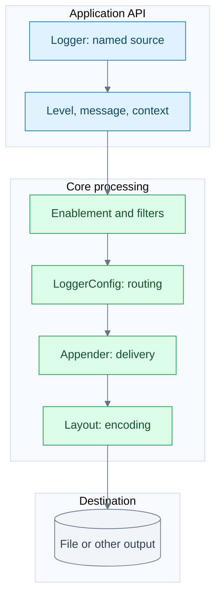

# A mental model for Log4j

Remember responsibilities before class names: **who is logging, how severe is it, what happened, what context belongs with it, and where should it go?**

## Two views of the same event

This is a responsibility map. The exact method path and its reliability coordination appear in [One logging call](../architecture/logging-call.md).

## The vocabulary

| Concept | Meaning | Example |
| --- | --- | --- |
| `Logger` | Named, reusable entry point | `com.shop.OrderService` |
| `Level` | Severity | `ERROR` |
| `Message` | Content | `Payment failed for order {}` |
| `Marker` | Semantic label | `PAYMENT` |
| `ThreadContext` | Correlation metadata | `requestId=abc` |
| `LogEvent` | One occurrence containing those details | A particular failure at a particular time |
| `LoggerConfig` | Core routing and level configuration | A rule for `com.shop` |
| `Appender` | Destination integration | Rolling file |
| `Layout` | Output representation | JSON |
| `Manager` | Underlying resource handling | File handle |
| `LoggerContext` | Running logging environment | Active configuration and logger registry |

## Four distinctions to retain

One logger can produce millions of events. The message is only part of each event: timestamp, severity, source, context, and exception are separate information.

Many loggers can share one `LoggerConfig`. A logger named `com.shop.OrderService` can use a configuration named `com.shop` when there is no more specific match.

An appender delivers; a layout encodes. Changing text to JSON changes a layout. Changing console output to a file changes the destination configuration.

`LoggerContext` and `ThreadContext` are unrelated scopes: the former owns logging configuration, while the latter exposes thread-associated metadata. Crossing an application executor boundary requires deliberate context propagation.

## Predict the component

| Desired change | Component to investigate |
| --- | --- |
| Attach request ID to several calls | `CloseableThreadContext` |
| Send package logs to a dedicated file | `LoggerConfig` and appenders |
| Output structured JSON | JSON Template Layout |
| Capture an SLF4J library's logs | An SLF4J provider |
| Implement a new output destination | Appender and resource manager |

## Recall

??? question "Does each Logger own a file?"
    No. Configuration routes events to appenders; managers handle output resources.

??? question "Is a Message the complete event?"
    No. It represents content; Core's event adds severity, time, source, context, and other event information.

## Source anchors

- [LoggerConfig](https://github.com/apache/logging-log4j2/blob/ae4117e25816346cfb749946e52e713fad397b86/log4j-core/src/main/java/org/apache/logging/log4j/core/config/LoggerConfig.java): event creation and routing.
- [AbstractConfiguration](https://github.com/apache/logging-log4j2/blob/ae4117e25816346cfb749946e52e713fad397b86/log4j-core/src/main/java/org/apache/logging/log4j/core/config/AbstractConfiguration.java): logger-name lookup.
- [AbstractOutputStreamAppender](https://github.com/apache/logging-log4j2/blob/ae4117e25816346cfb749946e52e713fad397b86/log4j-core/src/main/java/org/apache/logging/log4j/core/appender/AbstractOutputStreamAppender.java): encoding and manager access.
