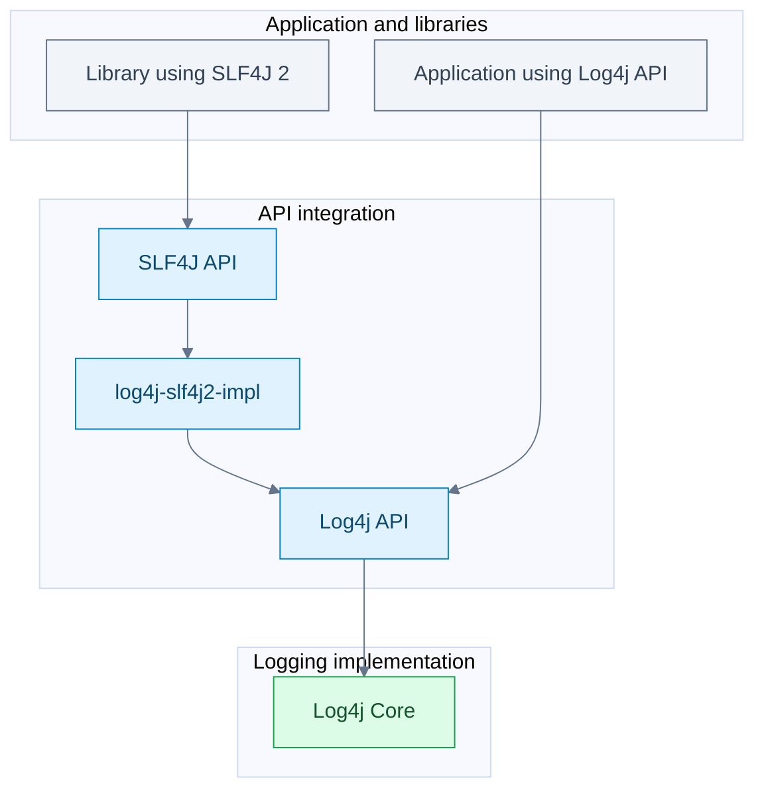

# Why SLF4J exists

SLF4J is a logging facade: it lets a library describe events while the application chooses the logging implementation. Log4j API also separates calls from implementations; both appear in applications because dependencies choose different APIs.

## Follow the arrows

Both callers reach the same engine. They can share its appenders, layouts, and routing configuration.

## Read bridge names as directions

| Artifact | Direction |
| --- | --- |
| `log4j-slf4j2-impl` | SLF4J 2 -> Log4j API |
| `log4j-slf4j-impl` | Older SLF4J binder API -> Log4j API |
| `log4j-to-slf4j` | Log4j API -> SLF4J |
| `log4j-jul` | Java Util Logging -> Log4j |
| `log4j-to-jul` | Log4j API -> Java Util Logging |

Choose the direction that leads to the application's intended backend. Do not combine opposite bridges to form a cycle.

## What the provider does

`SLF4JServiceProvider` exposes the SLF4J 2 implementation. `Log4jLoggerFactory` creates wrappers, and `Log4jLogger` translates calls. Marker and MDC adapters connect the corresponding concepts.

In the inspected checkout, `Log4jEventBuilder` converts fluent key-value values to strings and puts them into temporary thread context while making the logging call. A context-aware layout can then include them in output.

The alternative route is `SLF4J API -> Logback`. A library's SLF4J logging calls can stay unchanged while the application selects that backend instead.

## Recall

??? question "Do I need SLF4J just to use Log4j?"
    No. Your code can use Log4j API directly. A provider is useful when dependencies log through SLF4J.

??? question "Can log4j-to-slf4j and log4j-slf4j2-impl be combined?"
    No. They route in opposite directions. The SLF4J-to-Log4j factory explicitly rejects the conflicting context.

## Source anchors

- [SLF4JServiceProvider](https://github.com/apache/logging-log4j2/blob/ae4117e25816346cfb749946e52e713fad397b86/log4j-slf4j2-impl/src/main/java/org/apache/logging/slf4j/SLF4JServiceProvider.java).
- [Log4jLoggerFactory](https://github.com/apache/logging-log4j2/blob/ae4117e25816346cfb749946e52e713fad397b86/log4j-slf4j2-impl/src/main/java/org/apache/logging/slf4j/Log4jLoggerFactory.java): conflict validation.
- [Log4jEventBuilder](https://github.com/apache/logging-log4j2/blob/ae4117e25816346cfb749946e52e713fad397b86/log4j-slf4j2-impl/src/main/java/org/apache/logging/slf4j/Log4jEventBuilder.java): fluent call translation.
